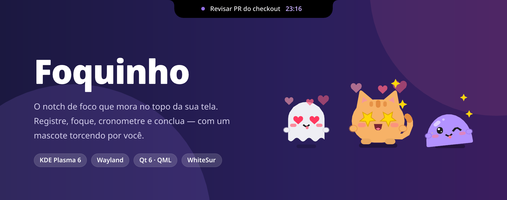
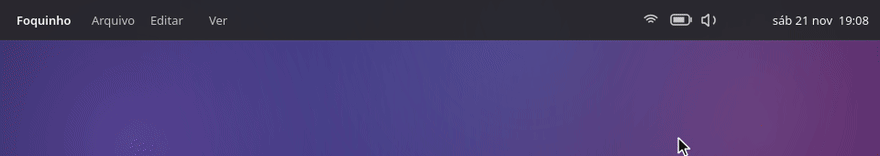
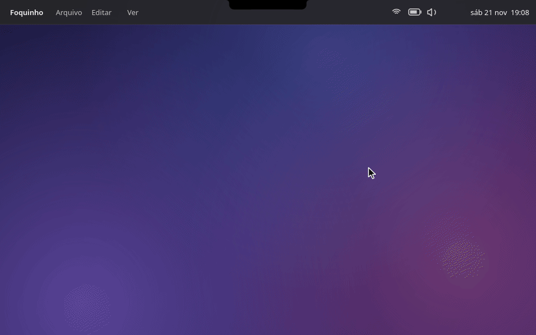
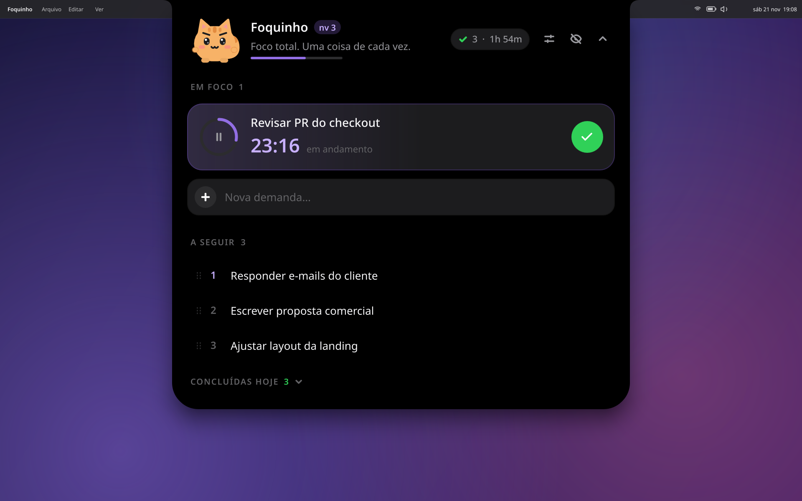
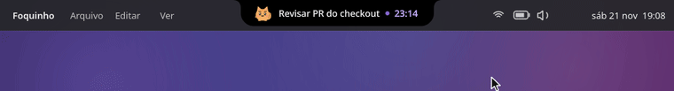
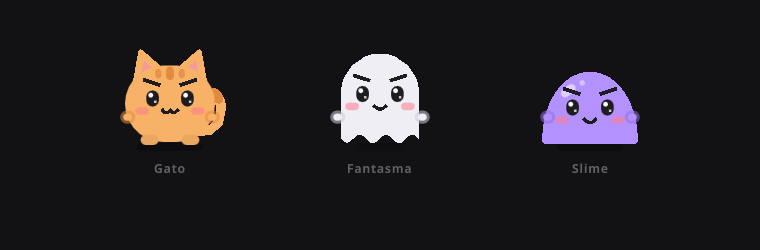
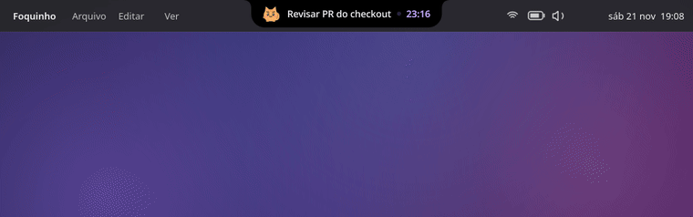
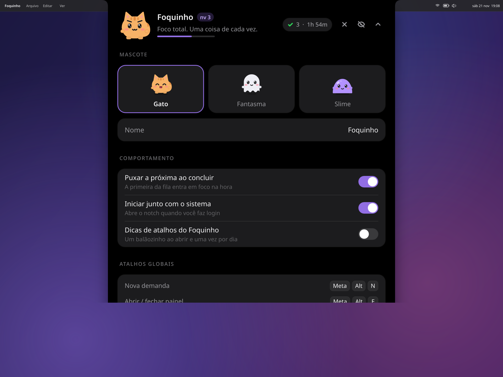

<p align="center">
  
</p>

<p align="center">
  
  
  
  
  
</p>

<p align="center">
  <b>Foquinho</b> é um notch animado para o KDE Plasma que deixa <b>o que você está fazendo agora</b> sempre à vista.<br>
  Você registra uma demanda em dois segundos, coloca em foco, vê o cronômetro correndo e, quando termina,<br>
  a próxima da fila já entra sozinha. Tudo isso com um mascotinho torcendo por você.
</p>

<p align="center">
  
</p>

---

## ✨ Por que o Foquinho?

Lista de tarefas a gente esquece aberta numa aba. O Foquinho fica **pendurado no topo da tela, por cima de tudo**
(até de app em tela cheia), encaixado na barra do tema WhiteSur como se fosse parte do sistema.
Ele só some se **você** mandar.

- 🎯 **Foco que não sai da sua vista.** A demanda atual e o tempo gasto ficam sempre visíveis.
- ⚡ **Registrar é instantâneo.** Um atalho, digita, Enter. Pronto.
- 🔁 **A fila anda sozinha.** Concluiu? A próxima já entra em foco.
- 🐱 **Um mascote com personalidade.** Ele dorme, comemora, se assusta, fica cansado e pede carinho.
- 🎨 **Parece nativo.** Cantos, sombras, fontes e a cor de destaque do seu KDE, em tempo real.

---

## 🚀 Registre e foque em segundos

Clique no notch (ou aperte <kbd>Meta</kbd>+<kbd>Alt</kbd>+<kbd>N</kbd> de qualquer lugar) e escreva.
<kbd>Enter</kbd> manda pra fila, <kbd>Ctrl</kbd>+<kbd>Enter</kbd> coloca direto em foco.

<p align="center">
  
</p>

<table>
  <tr>
    <td width="50%" valign="top">
      <h3>⏱️ Cronômetro em cada demanda</h3>
      Várias demandas podem ficar em foco ao mesmo tempo, cada uma com seu tempo.
      O anel marca os segundos, e é só clicar nele para pausar ou retomar. Passou de 50 minutos?
      O Foquinho sugere uma pausa.
    </td>
    <td width="50%" valign="top">
      <h3>🧲 Fila que você reorganiza</h3>
      Arraste pela alça <code>⋮⋮</code> para mudar a ordem, dê duplo clique para renomear e
      use o 🎯 para puxar qualquer item pro foco. As concluídas do dia ficam guardadas,
      com o tempo gasto, e dá pra devolver qualquer uma pra fila.
    </td>
  </tr>
</table>

<p align="center">
  
</p>

---

## 🫧 Esconda numa bolinha

Precisa de tela limpa? Um clique no 👁️ (ou <kbd>Meta</kbd>+<kbd>Alt</kbd>+<kbd>H</kbd>) e o notch vira
uma bolinha discreta que pulsa enquanto o cronômetro roda. Clicou nela, tudo volta.

<p align="center">
  
</p>

---

## 🐾 Conheça o Foquinho

Gato, fantasma ou slime: escolha o seu. Ele reage a tudo que acontece e tem várias manias para parecer vivo.

<p align="center">
  
</p>

| Quando… | Ele fica… |
|---|---|
| não há nada em foco | 😴 dormindo, com *zzz* |
| você está focado | 😤 de sobrancelha determinada |
| uma demanda entra em foco | ⚡ empolgado, de punho pro alto |
| chega demanda nova na fila | ❗ assustado, com um pulinho |
| você conclui algo | 🤩 com olhos de estrela, corações e brilhos |
| você abre o painel | 👋 acenando |
| passa de 50 minutos | 😓 cansado, suando e suspirando |
| você clica nele | 😍 apaixonado (é carinho!) |
| ninguém está olhando | 🎵 cantarola, boceja, pisca, mexe a orelha e o rabo |

No painel ele **segue o cursor com os olhos** e sobe de **nível** a cada 5 demandas concluídas.

---

## 💬 Ele te lembra dos atalhos

Quando o app abre (e uma vez por dia), o Foquinho manda um balãozinho com os atalhos.
**“Ok, valeu!”** adia pro dia seguinte; **“Não mostrar mais”** desliga de vez (dá pra religar nos ajustes).

<p align="center">
  
</p>

---

## ⌨️ Atalhos globais

| Atalho | Ação |
|---|---|
| <kbd>Meta</kbd>+<kbd>Alt</kbd>+<kbd>N</kbd> | Nova demanda (abre o campo, digita, Enter e ele recolhe sozinho) |
| <kbd>Meta</kbd>+<kbd>Alt</kbd>+<kbd>F</kbd> | Abrir / fechar o painel |
| <kbd>Meta</kbd>+<kbd>Alt</kbd>+<kbd>H</kbd> | Esconder numa bolinha / mostrar |
| <kbd>Meta</kbd>+<kbd>Alt</kbd>+<kbd>D</kbd> | Concluir a demanda em foco |

Eles ficam registrados no KDE: dá pra trocar em *Configurações do Sistema › Teclado › Atalhos › Foquinho*.

---

## ⚙️ Do seu jeito

<table>
  <tr>
    <td width="55%"></td>
    <td valign="top">
      <ul>
        <li>Escolha o mascote e dê um nome pra ele</li>
        <li>Ligue ou desligue a fila automática</li>
        <li>Inicie junto com o sistema</li>
        <li>Ative ou não o balão de dicas</li>
        <li>A cor de destaque segue a do KDE automaticamente</li>
      </ul>
    </td>
  </tr>
</table>

---

## 📦 Instalação

Feito para **KDE Plasma 6 em Wayland** (testado no EndeavourOS / Arch). As dependências já vêm com o Plasma:

```bash
sudo pacman -S --needed base-devel qt6-base qt6-declarative layer-shell-qt kglobalaccel
```

Clone, compile e instale (sem CMake: só `g++`, `moc` e `rcc` do Qt):

```bash
git clone https://github.com/Vitorprogrammerjunior/Foquinho.git
cd Foquinho
make install
```

Isso instala em `~/.local` o binário `foco-max`, o ícone e o atalho no menu. Abra pelo menu (“Foquinho”) ou rode:

```bash
~/.local/bin/foco-max
```

Para desinstalar: `make uninstall`.

> 💡 O tema WhiteSur é opcional: o Foquinho funciona em qualquer tema do Plasma, mas foi desenhado para combinar com ele.

---

## 🖥️ Linha de comando

O Foquinho é instância única: chamar o binário de novo só manda comandos pra que já está rodando.
Isso facilita integrar com scripts, KRunner ou atalhos personalizados.

```bash
foco-max                         # inicia (ou abre o painel se já estiver rodando)
foco-max add "Revisar PR"        # adiciona à fila
foco-max focus "Ligar pro João"  # adiciona direto em foco
foco-max done                    # conclui a demanda em foco
foco-max pause                   # pausa / retoma tudo
foco-max hide | show | toggle | quit
```

---

## 🧠 Como funciona

```
┌──────────────────────── C++ (src/) ────────────────────────┐
│  LayerShellQt  → janela overlay ancorada no topo, sobre a   │
│                  barra, visível até em tela cheia           │
│  setMask       → só o notch recebe clique; o resto passa    │
│  KGlobalAccel  → atalhos globais registrados no KDE         │
│  kdeglobals    → cor de destaque ao vivo                    │
│  QLocalServer  → instância única + comandos via CLI         │
│  state.json    → ~/.local/share/foco-max/                   │
└─────────────────────────────┬──────────────────────────────┘
                              │
┌──────────────────────── QML (qml/) ────────────────────────┐
│  Store.qml   estado, cronômetros, fila e persistência       │
│  Main.qml    o notch e suas animações de mola               │
│  Pet.qml     o mascote em vetor, com expressões e reações   │
│  …           painel, fila arrastável, balão, ajustes        │
└────────────────────────────────────────────────────────────┘
```

Os cronômetros são honestos: se o computador desligar com uma demanda rodando,
o tempo conta só até a última vez em que o app esteve vivo.

---

## 🎬 Sobre as demos

Todas as imagens e GIFs deste README foram gerados pelo próprio código, com a interface real e dados fictícios,
por um gravador roteirizado que simula mouse e teclado:

```bash
python3 tools/demo/record.py hero panel hide tip pets   # GIFs
QT_SCALE_FACTOR=2 python3 tools/demo/record.py stills banner   # imagens em alta resolução
```

---

## 🗺️ Próximos passos

- [ ] Pomodoro opcional, com o mascote avisando a hora da pausa
- [ ] Histórico semanal com o tempo focado por dia
- [ ] Prioridades e cores nas demandas
- [ ] Mais mascotes e acessórios que ele ganha ao subir de nível

---

<p align="center">
  Feito com 💜 por <a href="https://github.com/Vitorprogrammerjunior">Vitor</a>, para quem tem mil abas abertas e um foco só.
</p>
